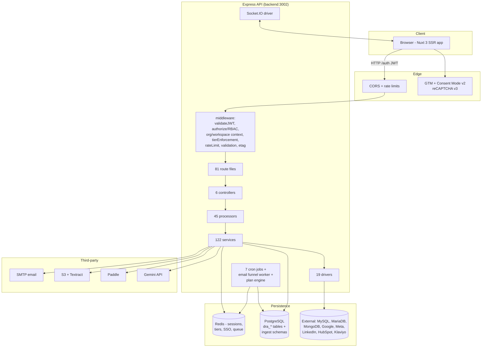

# 00 — System Overview

## Product context

Data Research Analysis (DRA) is a SaaS marketing intelligence and paid-media planning platform. Its flagship feature is the **Plan Studio**: an AI-driven, 18-step paid media plan builder (steps 0–17) that produces creative briefs, market research, media plans, tracking setups, and exportable deliverables (XLSX/PPTX/ZIP), which can be launched into campaign tracking in the marketing intelligence hub.

Secondary pillars:

- **Data ingestion**: connect marketing data sources (Google Ads, GA4, Google Ad Manager, Meta Ads, LinkedIn Ads, HubSpot, Klaviyo) and engineering sources (PostgreSQL, MySQL, MariaDB, MongoDB, Excel/CSV, PDF+OCR).
- **Data models & dashboards**: a medallion-layered (raw → clean → business-ready) data modeling layer with lineage, health scoring, refresh, AI data modeler, and interactive dashboards.
- **Marketing intelligence hub**: campaign analysis, attribution (6 models), funnels, anomaly detection, budget optimization, AI insights, and shareable reports.
- **Growth/marketing**: blog, lead generators, email funnels/broadcasts, sitemap, cookie-consent (GDPR/CCPA), conversion tracking.

## Repository layout

```
/ (root)                          — setup-cli.js, docker-compose.yml, Jenkinsfile
├── backend/                      — Express + TypeScript (ESM) API
│   └── src/
│       ├── index.ts              — application entry & boot sequence
│       ├── routes/               — 81 route files (54 root + 27 admin)
│       ├── controllers/          — 6 thin HTTP adapters
│       ├── processors/           — 45 business-logic singletons
│       ├── services/             — 122 services (110 root + 12 in subdirs)
│       ├── drivers/              — 19 drivers (DB, file, mail, socket, connectors)
│       ├── models/               — 77 TypeORM entities
│       ├── migrations/           — 137 migrations
│       ├── seeders/              — 9 seeders
│       ├── jobs/                 — 7 cron jobs + email funnel worker
│       ├── middleware/           — 13 middleware modules
│       ├── datasources/          — TypeORM datasource configs
│       ├── workers/              — worker-thread entry (service.js)
│       └── skills/paid-media/    — 18 skill packs for the plan studio
├── frontend/                     — Nuxt 3 (SSR) app
│   ├── pages/                    — 129 pages
│   ├── components/               — 218 lazy components
│   ├── stores/                   — 23 Pinia stores
│   ├── composables/              — 91 composables
│   ├── middleware/               — 8 global middlewares
│   └── plugins/                  — 18 plugins
├── documentation/                — feature docs, implementation summaries
│   └── architecture/             — this document set + PlantUML diagrams
└── docker/                       — Dockerfiles + entrypoints
```

## Technology stack

| Layer | Technology |
|---|---|
| Backend runtime | Node.js 24, TypeScript 5.9, ES Modules (`"type": "module"`, NodeNext resolution, `.js` import extensions) |
| Backend framework | Express 4.21 (`app.use` router mounting, top-level await boot) |
| Primary database | PostgreSQL (Citus image in dev) via TypeORM 0.3, 77 entities, 137 migrations |
| External source DBs | MySQL 8 (mysql2), MariaDB via TypeORM |
| NoSQL source | MongoDB 6 native driver (imported into PostgreSQL) |
| Cache / sessions | Redis 7 (ioredis) — AI sessions, OAuth tokens, SSO SAML store, rate-limit overrides, tier caches |
| Queue | theta-mn-queue (7 named queues) + Node worker_threads |
| Real-time | Socket.IO 4 (shared HTTP server with Express) |
| AI | Google Gemini (`gemini-2.5-flash` default), `@google/genai` SDK |
| Billing | Paddle (`@paddle/paddle-node-sdk`), webhook HMAC verified |
| Email | Nodemailer (SMTP) + Handlebars templates |
| Object storage / OCR | AWS S3 + Textract (via `@aws-sdk/*`) |
| Frontend | Nuxt 3.17 SSR + Vue 3.5, Pinia 3, Tailwind CSS 4, Vite 6 |
| Charts | d3 (custom chart components), html-to-image export |
| Markdown/XSS | marked + isomorphic-dompurify (allow-list sanitization) |
| Auth | JWT (jsonwebtoken), bcryptjs, passport-saml (`@node-saml/passport-saml`), reCAPTCHA v3 |
| Testing | Backend: Jest 30 (unit + integration + e2e + performance). Frontend: Vitest + @nuxt/test-utils |
| Process mgmt | PM2 (fork mode), Docker Compose dev stack |
| CI | Jenkinsfile (build frontend + backend) |

## High-level component diagram



## Runtime topology (docker-compose)

Six services on `docker_test_network`, all driven by root `.env` (backend additionally `backend/.env`):

| Service | Image | Role |
|---|---|---|
| `frontend.dataresearchanalysis.test` | node:22-alpine + `npm run dev` (NUXT_HOST=0.0.0.0) | Nuxt SSR app, port 3000 |
| `backend.dataresearchanalysis.test` | ubuntu:22.04 + Node 24 + PostgreSQL 18 client + Ghostscript + python-pptx | Express API + Socket.IO, port 3002 |
| `database.dataresearchanalysis.test` | citusdata/citus | Primary PostgreSQL (external volume) |
| `redis.dataresearchanalysis.test` | redis:7-alpine | Cache/session store |
| `mysql-test-database.*` | mysql (oraclelinux9) | External MySQL data-source testing |
| `mariadb-test-database.*` | mariadb (lts-ubi9) | External MariaDB data-source testing |

Production runs via PM2: `frontend/ecosystem.config.cjs` (`DRA-Frontend-Marketing`, `.output/server/index.mjs`) and `backend/ecosystem.config.cjs` (`DRA-Backend-Marketing`, `ts-node src/index.ts`).

## Key architectural decisions (summary)

1. **ESM + TypeScript everywhere** with NodeNext resolution (`.js` extensions in relative imports); top-level `await` boot sequence in `index.ts`.
2. **One HTTP server** shared by Express and Socket.IO (`SocketIODriver.initialize(httpServer)`).
3. **Processor/service singleton pattern**: private constructor + static `getInstance()` for all 45 processors and most services.
4. **Driver abstraction over EDataSourceType**: `DBDriver.getDriver(type)` factory returns Postgres/MySQL/MariaDB/MongoDB drivers; `IAPIDriver` for ad/CRM connectors.
5. **Multi-tenant via application-level RBAC**, not Postgres RLS: `DRAOrganization → DRAWorkspace → DRAProject → resources`, with `organization_id`/`workspace_id` propagated on 23/13 tables.
6. **Tier enforcement centralized** in `TierEnforcementService` + `tierEnforcement` middleware (HTTP 402 on limit violation), Redis-backed 30s count cache.
7. **Encryption via TypeORM ValueTransformer** (AES-256-GCM) for `DRADataSource.connection_details` — transparent to business logic.
8. **Materialized data models**: SQL queries execute and results are physically copied into PostgreSQL tables (`public."{name}_dra_{uuid}"`) for dashboard querying.
9. **File-based sources get their own schemas** (`dra_excel`, `dra_pdf`, `dra_mongodb`, `dra_google_ads`, …) with hash-based physical table names (`ds{id}_{md5[:8]}`).
10. **AI usage is metered**: every Gemini call records a `DRAAICallLog` row (`AICallTrackerService`) keyed by feature for per-feature cost comparison and per-tier cost ceilings.
11. **Durable plan execution engine**: in-process loop that drives plan steps one at a time, pauses at user gates, recovers interrupted steps, and auto-approves gates in basic mode.
12. **Cascade deletion with physical cleanup**: TypeORM cascades + manual `DROP TABLE`/`DROP SCHEMA` inside transactions.

## Cross-cutting concerns

- **Observability**: Winston structured logging (SSO audit), `PerformanceMetrics`/`globalPerformanceAggregator` (p50/p95/p99), frontend Web-vitals (`useSSRPerformance`), per-route navigation instrumentation.
- **Security posture**: AES-256-GCM at rest, JWT (non-expiring, cookie-bound 3-day), SAML SSO with replay protection + one-time codes, HMAC webhook verification, proxy-aware rate limiting, DOMPurify allow-list on all markdown, SQL validation services, reCAPTCHA on data-source connects and enterprise inquiry, GDPR 90-day webhook TTL and account deletion pipeline.

See [01 — Backend Architecture](01-backend-architecture.md) for the boot sequence and request pipeline, and [10 — Deployment & Observability](10-deployment-observability.md) for environment configuration.
